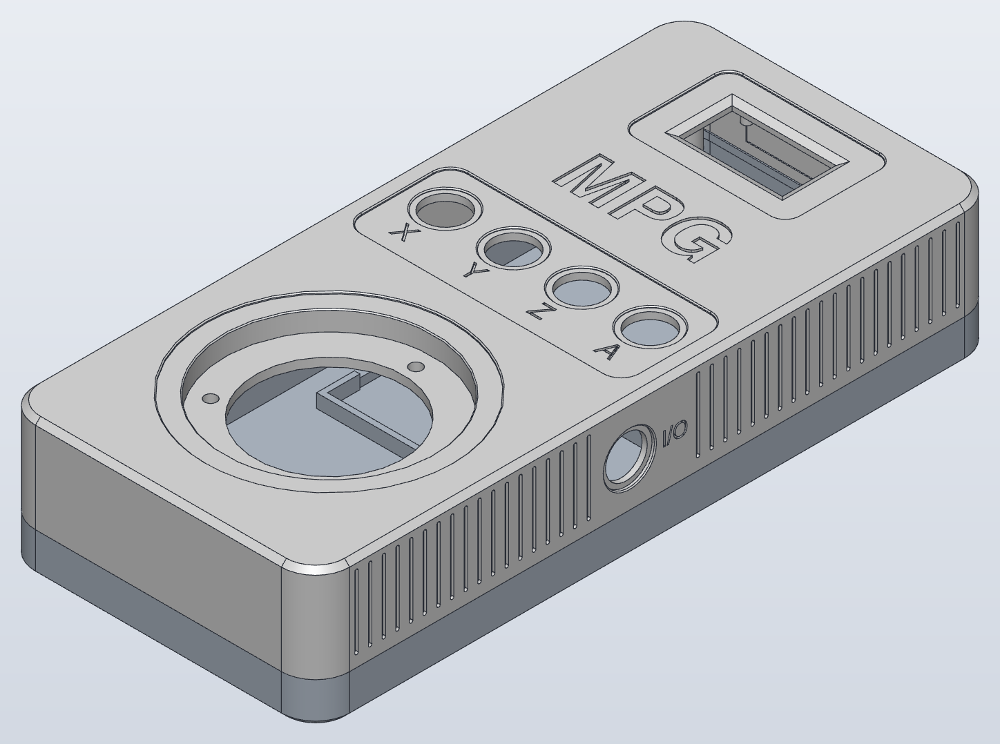
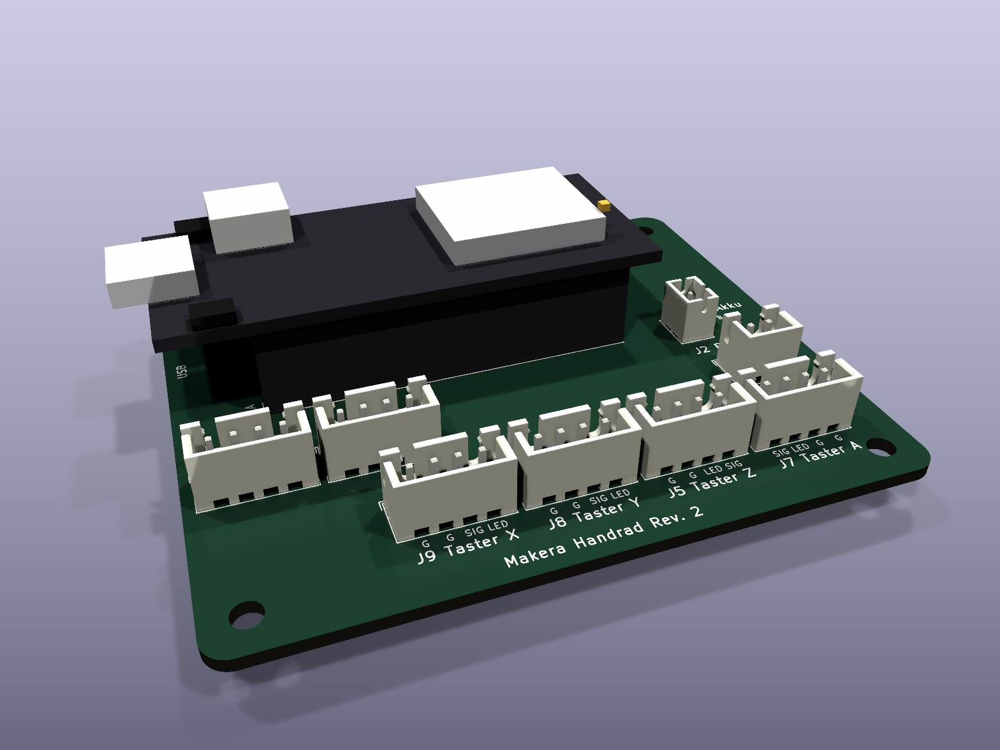

# Makera jog wheel

A battery-powered Wi-Fi handwheel (MPG, manual pulse generator) for the **Makera Z1 Pro** desktop CNC mill. An ESP32 (DFRobot **FireBeetle 2 ESP32-UE**) with a 100-pulse handwheel, four axis buttons and a 1.3″ OLED connects directly to the machine over Wi-Fi and jogs X, Y, Z and optionally the rotary axis A. No PC needed, and it works alongside Makera Studio.



> **Safety first. Read the [safety notice](#safety) before you connect this to a machine.**

The firmware's user-facing texts (display, web UI, serial output) are in German; all documentation is in English.

## Features

- **Jog gate.** The machine only moves when an axis is selected, a fresh machine status is available and the machine is ready. A running job, an alarm, a stale status or lost Wi-Fi lock the wheel; motion by another client ends the jog session ([SPEC 8.5](SPEC.md), [8.7](SPEC.md)).
- **Bounded overrun.** Commands are planned inside a small window ahead of the machine position. When the wheel stops, the machine stops after at most that window (5 mm X/Y, 1 mm Z, 2° A); surplus detents are dropped, never queued ([SPEC 8.7](SPEC.md)).
- **Speed-dependent step size.** Slow turning moves 0.01 mm per detent, faster turning 0.05 and 0.1 mm, no range switch. The feed rate follows the turning speed and is capped by the machine's own maximum rates, read at runtime ([SPEC 8.6](SPEC.md)).
- **Axis selection** with lit buttons, auto-deselect after inactivity, and an optional rotary axis A.
- **Unlock after an alarm** by holding an axis button for 5 s (sends `$X`, like the unlock dialog in Makera Studio). Nothing moves afterwards without new turning ([SPEC 8.10](SPEC.md)).
- **Setup portal.** First start (or X held at power-on) opens an access point with a captive portal for Wi-Fi credentials, machine IP and options. No code changes needed.
- **Web UI** in normal operation (`http://handrad.local/`): read-only status page with machine state, position and battery, a 2D position map of the spoilboard and a 3D view (three.js, served from the handwheel's flash, no internet needed); password-protected settings page.
- **OTA updates** over Wi-Fi (espota), opt-in, password-protected, refused while an axis is selected or the battery is low ([SPEC 9.5](SPEC.md)).
- **Soft power.** The on/off button is an input; off means deep sleep, so the battery keeps charging over USB-C while the handwheel is off ([SPEC 9.3](SPEC.md)).
- **Battery monitoring**, low-battery warning and an orderly shutdown when empty; screensaver against OLED burn-in.
- **Tested core logic.** Everything that decides about motion lives in `lib/core` (plain C++17, no Arduino) and is covered by Unity tests that run on the host.

## Hardware

- **Bill of materials:** [`hardware/BOM.md`](hardware/BOM.md) (FireBeetle 2 ESP32-UE, ZSS600 handwheel, SH1106 OLED, 12 mm LED push buttons, 1S LiPo, u.FL antenna, connectors, screws).
- **Carrier board:** single-sided, millable 78 × 66 mm board, generated with KiCad's Python API. Gerber, drill and SVG/PDF files: [`hardware/README.md`](hardware/README.md), [`hardware/handrad_pcb/fab/`](hardware/handrad_pcb/fab/).
- **Enclosure:** printable two-part handheld enclosure (92 × 200 × 40 mm), STL and STEP: [`hardware/enclosure/README.md`](hardware/enclosure/README.md).
- **Wiring and pin map:** [`WIRING.md`](WIRING.md), GPIOs in [`include/pins.h`](include/pins.h).
- **Bring-up checks:** [`HARDWARE_CHECKLIST.md`](HARDWARE_CHECKLIST.md) lists everything that can only be verified on real hardware. Work through it before trusting the handwheel with a machine.



## Build and flash

Requires [PlatformIO](https://platformio.org/).

```bash
pio test -e native                 # unit tests of the core logic on the host
pio run -e firebeetle              # build the firmware
pio run -e firebeetle -t upload    # flash over USB
pio device monitor                 # serial console, 115200 baud
```

Over Wi-Fi, once "Update über WLAN erlauben" (allow update over Wi-Fi) is enabled in the settings and no axis is selected; the password is the handwheel password shown during setup:

```bash
HANDRAD_OTA_PASS=<handwheel password> pio run -e firebeetle-ota -t upload
```

The generated web assets (`src/web_assets.h`) are rebuilt with `python3 -I tools/make_web_assets.py`. Setup, the portal and all screens are described in [`SPEC.md`](SPEC.md) chapters 9 and 10.

## Documentation

- [`SPEC.md`](SPEC.md): the full specification (architecture, machine protocol, jog logic, constants, tests, acceptance criteria).
- [`DECISIONS.md`](DECISIONS.md): every design decision with question, decision and rationale, including the accepted residual risks.
- [`WIRING.md`](WIRING.md): netlist, connectors, safety notes.
- [`HARDWARE_CHECKLIST.md`](HARDWARE_CHECKLIST.md): manual hardware checks.

Some documents mention files that exist only in the author's private working copy (third-party CAD models, the Makera logo). They are not part of this repository; the firmware, board and enclosure build without them.

## Safety

This is a hobby project, provided **as is, without any warranty** (see [`LICENSE`](LICENSE)). It moves a real machine with a spinning tool.

- The handwheel **can move the machine**. A firmware bug, a hardware fault, a wrong pin map or a misread status can cause unexpected motion. Within the documented limits the machine may also keep moving for a short distance after the wheel stops.
- It is **not an emergency stop** and not a safety device. Keep the machine's own emergency stop within reach at all times.
- Test carefully: work through [`HARDWARE_CHECKLIST.md`](HARDWARE_CHECKLIST.md), start without a tool and with the spindle off, at a safe height, with small steps, and read the residual risks in [`DECISIONS.md`](DECISIONS.md) and [`WIRING.md`](WIRING.md).
- You use it at your own risk and are responsible for your machine, your workpiece and yourself.

## Trademarks

Makera and Carvera are trademarks of Makera Inc. This project is not affiliated with, endorsed by or sponsored by Makera; the names are used only to describe which machine the handwheel works with. The Makera logo is not included (the screensaver and the enclosure engraving show a neutral "MPG").

The spoilboard and rotary-axis dimensions in `include/spoilboard_geometry.h` and `include/a_axis_geometry.h` were derived (simplified hole positions and bounding boxes) from Makera's public CAD files at [github.com/MakeraInc/CarveraProfiles](https://github.com/MakeraInc/CarveraProfiles). The CAD files themselves are not included; `tools/make_spoilboard_geometry.py` and `tools/make_a_axis_geometry.py` regenerate the headers from your own download.

## Licence and third-party components

This project is licensed under the [MIT licence](LICENSE).

Third-party components:

- **three.js** 0.160.0 and its `OrbitControls` (`web/vendor/`, embedded gzipped in `src/web_assets.h`): MIT licence, © three.js authors, see [`web/vendor/three-LICENSE`](web/vendor/three-LICENSE).
- **KiCad libraries:** the board file contains footprints from the KiCad standard libraries and references their 3D models (not included); the board renders in `hardware/handrad_pcb/fab/` show those models. The KiCad libraries are licensed under CC BY-SA 4.0 with an exception for designs and generated files that use them ([kicad.org/libraries/license](https://www.kicad.org/libraries/license/)).
- Fetched at build time by PlatformIO, not included: **U8g2** (BSD 2-clause), **Arduino-ESP32** and **ESP-IDF** (LGPL 2.1 / Apache 2.0), **Unity** test framework (MIT).

The simplified FireBeetle and pogo-pin models in `hardware/models/` are generated by `hardware/models/make_models.py` and are part of this project.
