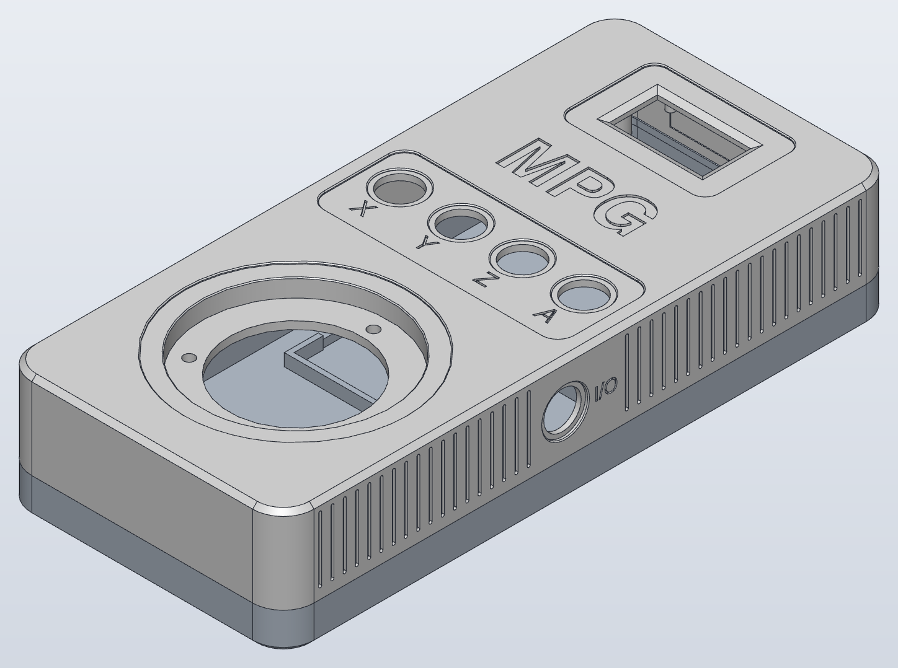
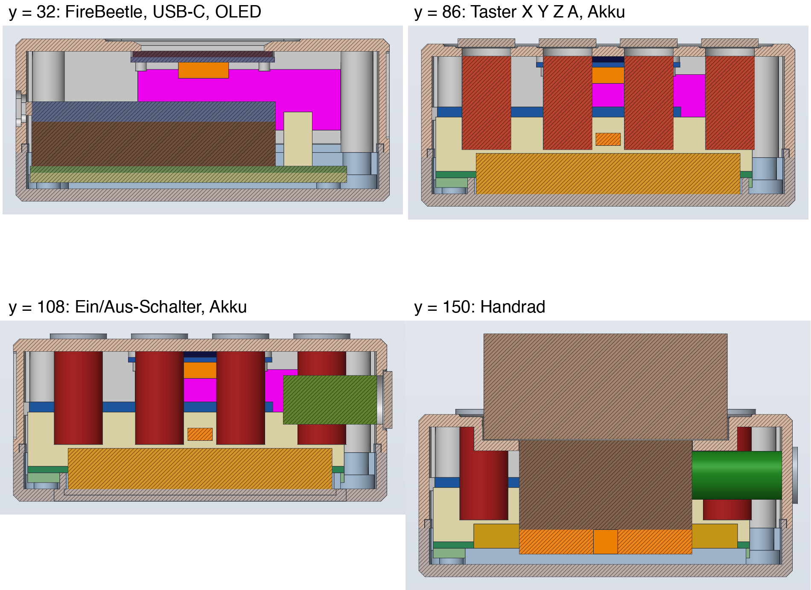

# Enclosure (ticket #30)

> **Logo notice.** The Makera logo is **not** included in the public version of this project. It is a trademark of Makera; this project is not affiliated with or endorsed by Makera. All printable files in this folder (`front_shell.stl`, `enclosure.step`, `handrad_enclosure.sc`, renderings) show the neutral engraving **"MPG"** (Helvetica bold), and `make_enclosure.py` builds that version by default.
>
> The private repository also holds the traced logo `logo_polygons.json` (ticket #50; the public export leaves it out). To engrave a logo, for private use only: trace it with `python3 -I trace_logo.py <logo.png>` (needs numpy and matplotlib; writes `logo_polygons.json` next to `make_enclosure.py`), then build the logo version with `--logo` as described under **Regenerate**. It goes to separate, git-ignored files (`enclosure_logo.json`, `handrad_enclosure_logo.sc`, `enclosure_logo.step`, `front_shell_logo.stl`), so the committed outputs stay neutral. Do not redistribute them.

Printable handheld enclosure **92 × 200 × 40 mm** made of two parts: **front shell** (z 12…40) and **bottom tray** (z 0…12), joined with 4 × M3 from below into heat-set inserts. Built with SolidCraft (`solidcraft-cli`).



## Files

| File | Contents |
|---|---|
| `make_enclosure.py` | Generates both scripts. All positions are given here in the ticket frame (see below). |
| `trace_logo.py` | Traces a logo from a picture as polygons into `logo_polygons.json` (`python3 -I trace_logo.py <logo.png>`). Contains no logo data. The picture is in no repository; `logo_polygons.json` is in the private repository only (see the notice above). |
| `enclosure.json` | SolidCraft script of both printable parts (source of truth for the geometry). Parameters: `W`, `L`, `H`, `wall`, `floor_t`, `front_t`, `split`, `r_corner`, `lip_off`, `lip_w`, `lip_h`, `gap`, `edge_c`. Further dimensions (pockets, engraving offset, display centre, USB-C) at the top of `make_enclosure.py`. |
| `assembly_check.json` | Placeholders of the built-in parts (boxes/cylinders) for the collision check. Check only, not a printed part. |
| `handrad_enclosure.sc` | SolidCraft design (bodies `FrontShell`, `BottomTray`) |
| `make_assembly.py`, `handrad_assembly.json` | Assembly with the real STEP models (ticket #31), see **Assembly**. The script contains only paths and positions. |
| `handrad_assembly.sc` | The built assembly. **Private repository only** (ticket #50), because it embeds the third-party models; the public export leaves it out. |
| `front_shell.stl`, `bottom_tray.stl` | Print data |
| `enclosure.step` | Both printed parts for CAD |
| `enclosure_iso.png`, `enclosure_front.png`, `enclosure_side_left.png`, `enclosure_side_right.png` | Views: oblique, from the front, from the left and from the right |
| `enclosure_inside.png` | Bottom tray with placeholders, front shell transparent, section at z = 30 |
| `enclosure_sections.png` | Sections at y = 32, 86, 108, 150 with placeholders |

Regenerate:

```bash
cd hardware/enclosure
python3 -I make_enclosure.py      # neutral "MPG": enclosure.json, assembly_check.json (committed)
solidcraft-cli run enclosure.json --save handrad_enclosure.sc --out enclosure.step
# Logo version (private use, git-ignored outputs, needs logo_polygons.json):
#   python3 -I make_enclosure.py --logo      # writes enclosure_logo.json only
#   solidcraft-cli run enclosure_logo.json --save handrad_enclosure_logo.sc --out enclosure_logo.step
#   STL as below with --in handrad_enclosure_logo.sc and "path":"front_shell_logo.stl"
# STL per part, as a script with --in handrad_enclosure.sc:
#   {"command":"file.export_stl","params":{"path":"front_shell.stl","bodies":["FrontShell"],"quality":"fine"}}
#   {"command":"file.export_stl","params":{"path":"bottom_tray.stl","bodies":["BottomTray"],"quality":"fine"}}
# Collision check: assembly_check.json with --in handrad_enclosure.sc, then inspect.interference
# Renderings (ticket #45), cropped to the model with a 30 px margin:
#   solidcraft-cli snapshot --in handrad_enclosure.sc --view iso --no-grid --no-axes --width 2400 --height 1800 --body FrontShell:color=#d8d8d8 --out …
#   solidcraft-cli snapshot --in handrad_enclosure.sc --view top --no-grid --no-axes --width 900 --height 1800 --body FrontShell:color=#ffffff --out …
```

The engraving only changes the front shell (`front_shell.stl`, `enclosure.step`, `handrad_enclosure.sc`); `bottom_tray.stl` and `assembly_check.json` stay the same.

Fits can be changed via the parameters (`parameters.change`): `gap` (lip clearance) tested, 0.2 → 0.3 rebuilds cleanly. Do not change `wall` and the outer dimensions via parameters (rebuilding with `wall` = 3 fails because bosses, webs and cut-outs have fixed positions); change them in `make_enclosure.py` and regenerate. The positions of the built-in parts are fixed numbers from `make_enclosure.py`.

Third-party models (FireBeetle, OLED, buttons, handwheel) are only in the private repository (`hardware/vendor/`, ticket #50), not in the public export; the check here uses placeholders. The assembly checks with the real models (see below).

## Coordinates

Ticket frame, in which all dimensions in this document are given:

- **x** 0…92: width, from left to right in the front view
- **y** 0…200: length, **y = 0 at the top end** (display), increasing towards the handwheel
- **z** 0…40: height, z = 0 bottom face, z = 40 front face (towards the user)

Like the KiCad top view, this frame is **left-handed**. SolidCraft works right-handed. In the CAD model (`.sc`, `.step`, `.stl`) therefore **Y_CAD = 200 − y**; x and z are the same. Seen from the front (+Z), the display is then at the top and the USB-C socket on the left, as in reality. With y taken over unchanged, the enclosure would be mirrored and would not fit the board.

## Design

| Feature | Dimension |
|---|---|
| Outside | 92 × 200 × 40, corners r 10 (vertical), front and bottom edge chamfered 1.5 × 45° |
| Wall / front / floor | 2.5 / 3 / 3 mm |
| Front fields | 0.6 deep, edge chamfered 0.3: display x 22…70, y 9…40.5 r 4; button band x 5.5…86.5, y 74…105 r 5; circle Ø 72 around the handwheel (46, 150). Button pockets stay 1.0 below the original front (0.4 below the field floor, remaining plate 2.0). |
| Engraving | Neutral (committed outputs, ticket #45): "MPG" in Helvetica bold, cap height 14, centre x 46, y 57, 0.6 deep, width ≈ 41.6. With `make_enclosure.py --logo` (`logo_polygons.json`, ticket #50): traced logo "M" + "PG" (Helvetica bold), same cap height, centre, depth, width ≈ 44. Remaining plate 2.4. |
| Grip grooves | Only in the two long walls, along the whole straight wall: y 12…188, pitch 4, 1.0 wide, 0.8 deep, vertical from z 15.3 (1.1 above the rebate, ≥ 1.2 mm remain at the rebate corner) to z 37.0 (1.5 mm below the edge chamfer), round ends. The front stays untouched. Left out (computed from the positions in `make_enclosure.py`, 2 mm clearance): right, switch pocket and "I/O" (no grooves at y 92…116); left, the USB-C recess (y 24…40). 40 grooves left, 38 right. Remaining wall 1.7. |
| Split | z = 12. Lip on the bottom tray 1.2 wide × 2 high (1.5…2.7 mm from the outside, 0.2 mm protrudes inwards past the wall). In the front shell a **rebate** (step, open towards the inside) 1.3…2.9 mm from the outside × 2.2 high: outer skin 1.3 mm, 0.2 clearance outside and on top. The lip centres the shells all around via the outer skin; a closed groove does not fit into a 2.5 mm wall (1.2 + 2 × 0.2 + 2 × 1.2 > 2.5). |
| Enclosure screws | (8, 8), (84, 8), (8, 192), (84, 192). Front shell: boss Ø 8 from the front plate down to z 12, hole Ø 4.0 × 6 for a heat-set insert, web to the enclosure corner. Bottom tray: foot Ø 10 up to z 6.5, column Ø 7 up to z 12, web to the corner, through hole Ø 3.4, counterbore Ø 6.5 × **6** from below. |
| Board mounts | 4 bosses Ø 6 at (8, 16.5), (77, 16.5), (8, 73.5), (77, 73.5), floor up to z 7, pilot hole Ø 2.5 × 5.5. Board z 7…8.6, copper/SMD facing down (4 mm air to the floor). |
| USB-C | Almost flush (ticket #34): cut-out in the left wall **9.94 × 4.16, r 1.8**, centre **y 31.2**, z 22.8 (y 26.23…36.17, z 20.72…24.88, front shell) = socket face 8.94 × 3.16 r 1.3 + 0.5 all around. Position as measured on the test print: the real socket sits 0.8 closer to the display than in the KiCad STEP (there centre y 32.0, z 22.875), see DECISIONS. The socket face is flush with the inner wall surface (x 2.5). Outside a recess 15 × 9, r 2, remaining wall 1.2 mm (size unchanged, centred on the cut-out, y 23.7…38.7), so that an overmoulded plug goes in fully. |
| Display | **Horizontal, centred** (`DISPLAY_CX` = 46): module x 28.3…63.7, y 10…43.5. Window 30.4 × 15.7 at x 30.8…61.2, y 16.85…32.55; outside chamfer 2 : 1 (2.0 on the front, 1.0 in depth), opening at the front 34.4 × 19.7, below that 1.4 mm vertical. 4 pegs at (30.8 / 61.2; 12.5 / 41) from the inside of the front: shoulder Ø 5 × 1.5, peg Ø 2.8 through the Ø 3.0 holes of the module and **2.2 mm beyond** for heat staking. Pocket 11 × 3 × 0.8 for the solder tips of the pin header (x 40.7…51.7, remaining plate in the field 1.6). Relief 23 × 11 × 0.4 on the inside over the flex cable at the lower glass edge (x 34.5…57.5, y 33…44, ticket #31). Module dimensions: see DECISIONS. |
| Axis buttons | 4 × Ø 12.2 at y 86, x 16/36/56/76, each with a pocket Ø 15 × 1 for the head Ø 14 (edge chamfered 0.3, remaining plate 2 mm). Engraving X, Y, Z, A 0.6 deep (from the field floor), 5 high, centre **11.8 mm** below the hole centre = 1.5 mm clear of the pocket edge including chamfer (`LABEL_OFFSET` from `BUTTON_POCKET_D`). |
| On/off | Latching 12 mm metal push button (same series as the axis buttons) in the **right side wall** at y 108, z 25: hole Ø 12.2, pocket Ø 15 × 1 for the head Ø 14 (edge chamfered 0.3, remaining wall 1.5), same parameters as the axis buttons. Engraving "I/O" 4 high, 0.5 deep next to it (towards the display), 1.5 mm beside the pocket edge (y ≤ 98.7). |
| Handwheel | Recessed (ticket #31): seat of the flange Ø 60 × 6 at z 33.6, i.e. **6.4 below the front**; the flange sits 0.4 below the front (0.2 above the field floor). Because the front is only 3 thick, a **pot** protrudes inwards: shaft Ø 61 (top edge chamfered 0.3), wall 2 (outside Ø 65), floor 2.5 (z 31.1…33.6) with cut-out **Ø 43** and 3 × Ø 3.5 on a PCD of 50.8, one at 12 o'clock (46, 124.6), the others at ±120°. Centre (46, 150). The M3 studs of the handwheel (10 long) protrude 7.5 behind the floor (nut + washer). |
| Battery | Frame of ribs 1.6 × 4 around 65 × 35 (0.5 clearance), x 13.5…78.5, y 82…117. Right short side open (only 6 mm corners) for the cable. Hook-and-loop strap: 2 slots 2.5 × 17 in the floor **outside** the pocket (x 10…12.5 and 79.5…82, y 91…108); the left rib has a gap there. Outside in the floor a channel 17 × 1.5 deep connects the slots (1.5 mm floor remains), the strap lies flush. Strap from below through one slot, over the battery, back through the other. |
| Antenna | Adhesive PCB antenna 50 × 15 on the inside of the top end wall (inner face y = 2.5), ticket #44: locating recess **51 × 16 × 0.3** (0.5 clearance per side, x 20.5…71.5, z 17…33, remaining wall 2.2), free area 55 × 19 (x 18.5…73.5, z 15.5…34.5), centre **x 46** (enclosure centre), z 25. No hole. |

Weight at 100 % infill (PLA 1.29 g/cm³): front shell 82.3 cm³ ≈ 106 g, bottom tray 68.8 cm³ ≈ 89 g. Printed with 3 walls and 20 % infill considerably less.

## Parts list

Enclosure parts only; the complete bill of materials is in [`../BOM.md`](../BOM.md).

| Qty | Part |
|---|---|
| 4 | Socket head cap screw M3 × 10 (ISO 4762 / DIN 912), enclosure |
| 4 | Heat-set insert M3, length ≤ 6 mm, for hole Ø 4.0 (e.g. M3 × 5.7) |
| 4 | Thread-forming screw M3 × 6 for plastics (or self-tapping screw 2.9 × 6.5), carrier board |
| 3 | Nut M3 + washer (handwheel studs, inside at the pot floor) |
| 1 | Adhesive PCB antenna 2.4 GHz with u.FL, 50 × 15 mm, cable RF1.13 195 mm (sourcing map, Amazon B0816WKB5V) |
| 1 | Hook-and-loop strap 16 mm, approx. 20 cm |

Screw calculation: head seat at z 6, an M3 × 10 screw reaches z 16, i.e. 4 mm into the heat-set insert (z 12…18). With M3 × 12 you get 6 mm, but then you may only use an insert ≤ 6 mm and must mind the bottom of the hole (z 18): M3 × 12 ends exactly there. M3 × 10 is the safe choice.

## Printing

- **Material:** PETG (preferred, tougher at screw bosses and lip) or PLA. Layer 0.2 mm, nozzle 0.4, 3 walls (1.2 mm), top/bottom 4 layers, 20 % gyroid.
- **Front shell with the front on the bed.** Engravings, window chamfer and hole edges are then on the bed. Bosses, webs and display pegs grow vertically from the plate, no overhangs. The rebate is at the top.
  - **USB-C cut-out:** horizontal in the wall, the upper edge is a bridge just under 10 mm long with radii r 1.8. Prints without supports.
  - **On/off hole Ø 12.2:** horizontal bore; the upper arc overhangs slightly. Prints without supports; if it sags, rework with a round file until the M12 thread goes through.
  - "I/O" engraving and grip grooves in the side walls: run in print direction, no supports.
  - Fields, engraving and labels of the front are on the bed: shallow recesses, the first layer forms them.
  - Front edge 1.5 × 45° on the bed: no overhang, counters elephant's foot. Button pockets are shallow steps on the bed, no supports.
  - **Handwheel pot: supports from the build plate only** ("on build plate only") in the Ø 61 shaft, **with interface layers** (support interface on top enabled, 2–3 dense layers, Z distance 0.2 = one layer). The underside of the pot floor (handwheel seat, z 33.6) hangs 6.4 above the bed and projects 9 mm freely from the shaft inwards to the cut-out; without supports it sags. The supports stand in an open shaft and can be broken out from the front; then check the seat and scrape it flat slightly if needed, otherwise the handwheel sits askew. Alternatives see DECISIONS (ticket #31).
- **Bottom tray with the floor on the bed.** Bottom edge 1.5 × 45° on the bed. Counterbores and strap slots open towards the bed; the ceiling of the counterbore (z 6) is a short bridge with a Ø 3.4 hole. No supports.
- Insert the heat-set inserts vertically with the soldering iron (approx. 220 °C PLA, 240 °C PETG) before anything is installed.

## Assembly steps

1. Heat-set inserts into the 4 bosses of the front shell.
2. Display: put the module glass-first onto the 4 pegs (pin header towards the top end, solder tips in the pocket), heat-stake the peg ends protruding 2.2 mm with the soldering iron. Solder on the wires.
3. Buttons (nut inside; turn the 4 M12 nuts so that the flats face each other, otherwise at 20 mm spacing they collide across the corners), on/off switch (right wall, contacts inwards). Put the handwheel into the pot from the front, the 3 M3 studs through the pot floor, inside a washer + M3 nut each. Bend the handwheel wires right behind the body (8.6 mm remain to the floor of the bottom tray), lead them out towards the buttons, lay them up in front of the battery and over the battery between buttons Y and Z to the board (J6).
4. Stick the antenna (50 × 15) with its adhesive side into the 51 × 16 recess on the top end wall, cable exit to the right (towards the u.FL of the FireBeetle). The cable (195 mm) hangs free for now; it is only plugged in at step 7, when the front shell lies next to the bottom tray. On closing, the excess length (≈ 15 cm) goes as a loose, flat loop (oval about 45 × 12, bend radius ≥ 6 mm) onto the free edge of the carrier board in front of the FireBeetle (y ≈ 6…18, x ≈ 14…64, see **Antenna**), not over the antenna area and not down at the end wall where lip and rebate close.
5. Bottom tray: battery into the frame, cable towards the open right side, strap through the slots and around the battery.
6. Carrier board with FireBeetle onto the 4 bosses, 4 thread-forming screws M3 × 6.
7. Plug in the connectors (display J4, buttons, handwheel J6, switch J2, battery J1, antenna onto the u.FL of the FireBeetle), lay the antenna cable as a loop (step 4), put on the front shell (lip into the rebate), 4 × M3 × 10 from below.

## Antenna

- Ordered (ticket #44): adhesive PCB antenna **50 × 15 mm**, 5 dBi, u.FL, cable RF1.13 **195 mm**, adhesive surface on the back (sourcing map, Amazon B0816WKB5V).
- Stick it with the adhesive surface into the **51 × 16 × 0.3** recess on the inside of the top end wall (0.5 clearance per side, the recess is only for alignment). Stick it on plastic only.
- Position: centre x 46 (enclosure centre), z 25. Keep at least 10 mm from metal: to the heat-set inserts top left and top right (bosses at x 8 and 84) ≈ 10.5 mm remain on each side. The previous centre x 55 no longer worked, because the larger area would otherwise touch the top right boss. The display board lies ≈ 7.5 mm diagonally in front of it (y ≥ 10, z ≥ 34.3), handwheel (metal housing, y ≥ 129) and battery (y ≥ 82) are far away. If in doubt, let the RSSI measurement (H-15) decide.
- Cable: the u.FL sits at the right end of the FireBeetle (x ≈ 60, top z ≈ 24.5, y ≥ 19.3). The direct path is only 2…5 cm, ≈ 15 cm are excess length. It lies as **one loose, flat loop** (oval about 45 × 12, bend radius ≥ 6 mm, do not kink) in the free space between end wall and FireBeetle: y ≈ 6…18, x ≈ 14…64, z ≈ 9…14, i.e. on the free edge of the carrier board (y 12…19.3, on top only the mounting holes) and in front of it. To the right of it, from x 66, are the connectors J1/J2, left and right the bosses. Do not lay it over the antenna area and keep it at least 3 mm away from the end wall, so that the cable does not get between lip and rebate when closing. No holder needed; if necessary a strip of Kapton tape on the board.

## Check (ticket #30, handwheel pot ticket #31)

Placeholders in `assembly_check.json` (all positions in ticket coordinates): carrier board, SMD/pogo zone under the board (2.4 mm, without the top 2 mm edge and without Ø 7 around the mounting holes), female headers 11 mm, FireBeetle up to z 24.5, USB-C overhang, connector stack J1/J2 and the connector rows including cable plugs up to z 22, OLED (glass, board with holes, wires behind the pin header), battery, buttons (Ø 12 × 17 + 6 wires, head Ø 14 × 2 in the pocket), on/off (Ø 12 × 17 + 6 wires, head Ø 14 × 2 in the pocket), handwheel (body Ø 42.5 × 22 from the seat, front Ø 60 × 26 in the pot; wires as a chain: bend zone Ø 42.5 × 6 below the body (bundle 3 + bend radius 3), channel 6 × 3 radially out, up between body and battery rib to z 15…18 and over the battery between buttons Y and Z to the board edge), antenna area (free area 55 × 19 × 3, ticket #44).

- `inspect.interference` over all bodies: **no overlap** except the intended face contacts of the display and the chained sections of the wire placeholder (glass against the inside of the front 0.06 mm³, module board on the peg shoulders 0.016 mm³, both contact in one plane).
- Front shell against bottom tray (the kernel cannot intersect the contact face at z 12 directly): bottom tray copied 0.05 mm lower, no overlap, smallest distance 0.05 mm at the parting line. Lip in the rebate 0.2 mm clearance outside (section images).
- Smallest distances: USB-C placeholder (box 8.94 × 3.16 from the inner wall face, at the test-print position, centre y 31.2) touches the inner wall face only at its square edges next to the radii of the cut-out (distance 0, no overlap; the real socket is rounded, see Assembly). Buttons and on/off 0.1 mm radially to the hole, handwheel body 0.25 mm to the Ø 43 cut-out, handwheel wires 2.6 mm above the floor of the bottom tray, 1.9 to the battery rib, 2.0 above the battery (room for the strap) and 1.0 to buttons Y/Z, button heads and handwheel front 0.3 mm above the pocket or pot floor, SMD zone 0.5 mm above the screw feet.
- Antenna area (ticket #44, 55 × 19 × 3, centre x 46): touches the inner wall face (intended), no overlap with bosses, webs or placeholders. Distances: lip of the bottom tray 1.5 (below), display board and wires 4.5, carrier board 9.5, display glass 9.8, J1/J2 13.5, FireBeetle and female headers 13.8.
- Every feature checked individually against the computed volume change (e.g. fields −4835.8 mm³, computed 4835.6; grip grooves left 40 × 17.2, right 38 × 17.2 mm³; strap channel −1708.5).
- Minimum wall 1.2 mm: lip 1.2, outer skin at the rebate 1.3, remaining wall at the USB-C recess 1.2, plate under the display solder-tip pocket 1.6, over the display flex cable 2.0, grip grooves 1.7 (≥ 1.2 at the rebate corner), floor at the strap channel 1.5, under the labels 1.8, under the front engraving 2.4, under the button pockets 2.0, end wall at the antenna recess 2.2, handwheel pot wall 2.0 and floor 2.5 (web between cut-out and stud hole 2.15), boss around the heat-set insert 2.0, foot around the counterbore 1.75. Each part is one closed body (1 shell), nothing floats.
- Volume: front shell 82.3 cm³ (≈ 106 g PLA solid), bottom tray 68.8 cm³ (≈ 89 g). Antenna recess 51 × 16 instead of 46 × 12 (ticket #44): −79.2 mm³, computed (51 · 16 − 46 · 12) · 0.3 = 79.2; bottom tray unchanged. Neutral engraving (ticket #45): front shell 82 348.2 mm³, +8.6 mm³ against the logo version; bottom tray unchanged.



The collage still shows the USB-C cut-out before ticket #34 (12 × 7) in the y = 32 panel; the other panels are current.

## Assembly (ticket #31)

`make_assembly.py` builds `handrad_assembly.sc` with the real models: enclosure linked from `handrad_enclosure.sc` (front shell blue, bottom tray grey, both semi-transparent), plus carrier board with FireBeetle, display, 4 axis buttons, on/off button and handwheel at their installed positions. The positions (matrices) are in the script, the measured values of the models in DECISIONS (ticket #31).

The models are in the private repository only (sources and licences: `hardware/vendor/README.md`); the public export leaves them out, so there they must be supplied locally:

| File | Contents |
|---|---|
| `hardware/vendor/enclosure/oled_1p3.step` | SH1106 display 1.3″ |
| `hardware/vendor/enclosure/button_12mm.step` | 12 mm metal push button (axis buttons and on/off) |
| `hardware/vendor/enclosure/zss600.step` | Handwheel 60 mm |
| `hardware/handrad_pcb/fab/handrad.step` | Carrier board from KiCad (`hardware/export.sh`), contains the FireBeetle model |

```bash
cd hardware/enclosure
python3 -I make_assembly.py           # write handrad_assembly.json, build handrad_assembly.sc
python3 -I make_assembly.py --check   # additionally measure overlaps (takes about 20 min)
```

If a file is missing, the script stops with a list. `hardware/vendor/`, `fab/handrad.step` and `handrad_assembly.sc` (embeds the models; the FireBeetle model must not be redistributed) are committed in the private repository only and on the deny-list of `tools/strip_private.py` (ticket #50); the public export has only `make_assembly.py` and `handrad_assembly.json` (paths and positions, no geometry). After an enclosure change, regenerate `handrad_enclosure.sc` and run `make_assembly.py` again.

Check with the real models (`--check`, as of ticket #31):

- **No overlap** of the models with the shells and with each other. The check previously found 7.3 mm³ between the display flex cable (0.1 above the glass) and the front; since then there is the relief over the flex cable (distance now 0.3).
- Not intersectable for the kernel, therefore inspected individually: display board on the peg shoulders (face contact at z 35.5, intended), handwheel (studs coaxial in the Ø 3.5 holes; clear in the section, body 0.25 to the Ø 43 cut-out), nuts of the 4 axis buttons: in the model they sit 0.3 mm inside the front plate, because the model draws the nut for a 1.7 mm wall (sealing ring on the pocket floor, remaining plate 2.0). That is the model's position, not a collision: the real nut is turned up to the plate. With the on/off button (remaining wall 1.5) 0.2 air remains.
- Smallest distances to the shells: thread of the buttons 0.14 radially in the Ø 12.2 hole, glass touches the front (0), USB-C socket: since ticket #34 the cut-out sits at the position measured on the test print (y 31.2), the model has the socket at y 32.0; in the assembly the wall therefore covers the socket face by 0.3 mm on the handwheel side (face touches the inner wall face, distance 0, no overlap). That is the model ↔ device deviation; with the model at the test-print position 0.425 (top) to 0.575 (bottom) remain, 0.5 at the sides, FireBeetle 1.4, display pin header 0.4 to the solder-tip pocket, pogo pins 2.0 above the floor, carrier board rests on the bosses (0).
